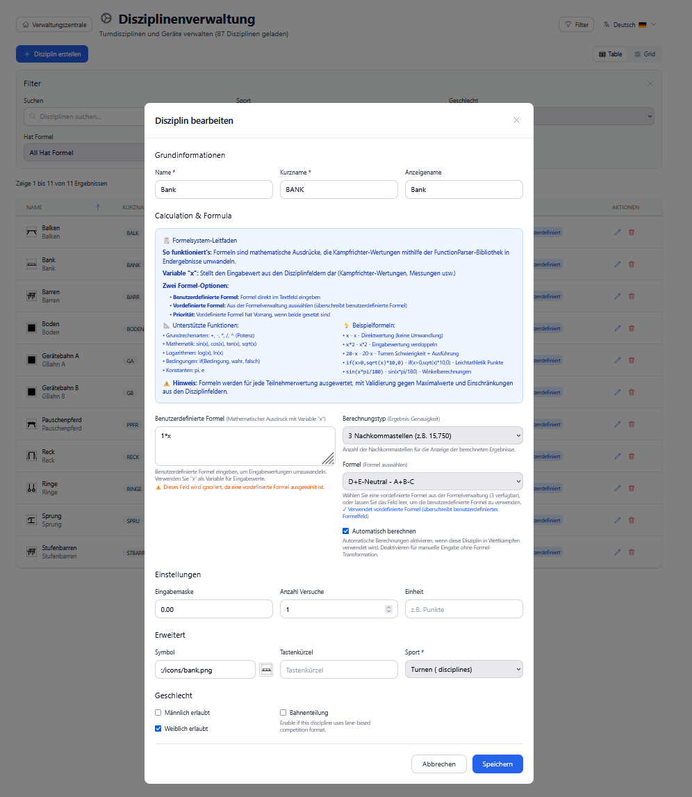

# Disziplinen verwalten

Eine Disziplin ist eine wiederverwendbare Definition für ein Gerät oder eine Übung, etwa Boden, Sprung oder 50-m-Lauf. Sie wird unter **Stammdaten → Disziplinen** angelegt und anschließend in einem oder mehreren Wettkämpfen ausgewählt. Änderungen an dieser gemeinsamen Definition können sich somit auf mehrere Veranstaltungen auswirken. Der Wettkampf selbst legt fest, *welche* Disziplinen dazugehören und welche Höchstpunkte dort gelten.

## Einstellungen im Disziplinformular

| Einstellung | Bedeutung |
|---|---|
| **Name**, **Kurzname**, **Anzeigename** | Vollständige Bezeichnung, kurze Kennzeichnung und optionaler längerer Anzeigename. Der Kurzname ist auf fünf Zeichen begrenzt. |
| **Sport** | Ordnet die Disziplin einer Sportart zu; sie muss ausgewählt werden. |
| **Männlich erlaubt / Weiblich erlaubt** | Kennzeichnen, für welche Wettkampfbereiche die Disziplin angeboten wird. Beide Häkchen ermöglichen die Verwendung für beide Bereiche. |
| **Benutzerdefinierte Formel** | Ein direkt an der Disziplin hinterlegter Ausdruck, z. B. `1*x` für eine unveränderte Leistung. `x` steht für den Eingabewert. |
| **Formel** | Auswahl einer gemeinsam verwalteten Formel. Ist eine verknüpfte Formel ausgewählt, hat sie Vorrang vor der benutzerdefinierten Formel. |
| **Automatisch berechnen** | Im Formular als Schalter für die Berechnung vorgesehen. Verlasse dich nicht allein darauf: Beim Neuanlegen und in einzelnen Erfassungswegen ist die Wirkung derzeit nicht verlässlich. Für direkte Eingabe ohne Umrechnung die Formelkonfiguration und den Wertungsmodus prüfen und mit einer Testwertung kontrollieren. |
| **Berechnungstyp** | Anzahl der Nachkommastellen für die Ergebnisanzeige, von 0 bis 3. |
| **Eingabemaske** | Legt das Eingabeformat fest, z. B. `0.00` für Dezimalzahlen oder `00:00.00` für eine Zeitangabe. |
| **Anzahl Versuche** | Hinterlegt die vorgesehene Anzahl der Versuche; das Formular erlaubt 1 bis 10. |
| **Einheit** | Kennzeichnung der Leistung, z. B. `m` oder `s`. |
| **Symbol** und **Tastenkürzel** | Optionale Darstellung bzw. Kurzkennung der Disziplin. |
| **Bahnenteilung** | Kennzeichnet Disziplinen, die mit Bahnen durchgeführt werden. |

Die **Eingabemaske** beschreibt das Format einer Leistung, die **Nachkommastellen** die Ergebnisanzeige und die **Maximalpunktzahl im Wettkampf** die dort geltende Grenze: Das sind drei unterschiedliche Einstellungen.

## Vorgehen und Prüfung

1. Sportart auswählen und Namen sowie Geschlechtsfreigabe eintragen.
2. Eingabemaske, Einheit, Versuche und Nachkommastellen passend zur Ausschreibung festlegen.
3. Falls nötig eine [Formel](formulas.md) auswählen oder eine eigene Formel eingeben. Für Formeln mit mehreren Eingabewerten die [Disziplinfelder](discipline-fields.md) konfigurieren.
4. Die Vorschau im Disziplinformular mit bekannten Eingabewerten prüfen, speichern und die Disziplin dem gewünschten Wettkampf zuordnen.
5. Vor dem Wettkampf auch die tatsächliche Eingabe und Ergebnisliste mit einer Testwertung kontrollieren. Die Vorschau ersetzt diesen End-to-End-Test nicht.

**Wenn eine Disziplin bei der Wettkampfauswahl fehlt:** Den Geschlechtsbereich der Disziplin, den Bereich des Wettkampfs sowie die Filter und die gewählte Disziplingruppe im Wettkampfformular prüfen. Dort kann auch auf „Alle anzeigen“ umgestellt werden.

Weiter: [Stammdaten und Veranstaltungsdaten](../stammdaten-und-veranstaltung.md) · [Wettkampfeinstellungen](../wettkampf-einstellungen.md)
